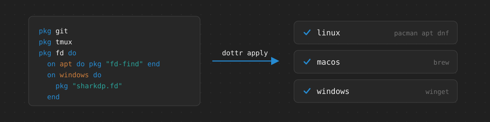

# dottr

dottr sets up a machine from a manifest. The manifest declares the packages
and configuration of the machine as units, written in a small language: a
unit installs a package, or runs shell scripts gated on checks of the host,
and may depend on other units. `dottr apply` brings the machine to the
declared state, and is run again whenever the manifest changes.

````dottr
pkg git
pkg tmux

pkg tpm do
  needs git, tmux

  local TPM_DIR = "@{dottr.env.home}/.config/tmux/plugins/tpm"
  check directory TPM_DIR
  apply_unless TPM_DIR do
    shell do
      ```
      git clone https://github.com/tmux-plugins/tpm "$TPM_DIR"
      ```
    end
  end
end
````

* Dependencies between units, applied in order; a failed unit skips only the
  units that depend on it.
* `dottr plan` shows what would be done before anything is changed.
* Shell scripts embedded as written, with the unit's variables in their
  environment.
* A formatter, a language server, and editor support for VS Code and Neovim.

dottr runs on Linux, macOS, and Windows and installs packages with the
system package manager: pacman, apt, or dnf on Linux, Homebrew on macOS, and
winget on Windows. One manifest can describe several systems.

## Installation

On Linux and macOS:

```
curl -fsSL https://raw.githubusercontent.com/tkamucheka/dottr/main/install.sh | sh
```

On Windows, in PowerShell:

```
irm https://raw.githubusercontent.com/tkamucheka/dottr/main/install.ps1 | iex
```

The scripts install the release archive for the platform for the current
user, or build dottr from source where there is none. Options, upgrading,
and removal are described in [Installation](docs/reference/installation.md).

## Usage

Write a manifest, `packages.dotfile`, and in its directory run:

```
dottr check              # validate the manifest
dottr plan               # show what apply would do
dottr apply              # apply every unit
dottr apply tmux         # apply tmux and the units it needs
dottr-format -w packages.dotfile
```

## Documentation

* [The Manifest Language](docs/reference/language.md)
* [Command Line](docs/reference/command-line.md)
* [Installation](docs/reference/installation.md)
* [Formatting](docs/reference/formatting.md)
* [Language Server](docs/reference/lsp.md)
* [Editors](docs/reference/editors.md): VS Code and Neovim
* [Grammar](docs/reference/grammar.md): the formal grammar of the language

## Building from Source

```
git clone --recurse-submodules https://github.com/tkamucheka/dottr.git
cd dottr
mkdir -p build
for p in dottr dottr-format dottr-lsp; do
  cc -std=c11 -Wall -Wextra -Iinclude lib/*.c tools/$p/$p.c -o build/$p
done
cc -std=c11 -Wall -Wextra -Iinclude lib/*.c test/*.c -o build/dottr-test
build/dottr-test
```

The editor support is developed in the submodules `utils/tree-sitter-dottr`
and `utils/vscode-dottr`.

## License

MIT; see [LICENSE](LICENSE).
